<h1 align="center">Hello World!!</h1>

 

  <a align="left" href="https://github.com/MatheusRyans" target="_blank">
    <picture>
      <source
        media="(prefers-color-scheme: dark)"
        srcset="https://img.shields.io/static/v1?label=Overview&labelColor=232F3E&message=MatheusRyans%20%F0%9F%87%A7%F0%9F%87%B7&color=003DA5&style=for-the-badge&logo=GitHub"
      >
      <source
        media="(prefers-color-scheme: light)"
        srcset="https://img.shields.io/static/v1?label=Overview&labelColor=38BDAE&message=MatheusRyans%20%F0%9F%87%A7%F0%9F%87%B7&color=628EDA&style=for-the-badge&logo=GitHub"
      >
      
    </picture>
  </a>

  Estudante de Desenvolvimento de Software e Engenharia de Software 

  Membro da Diretoria de Projetos da
  <a href="https://www.instagram.com/lamit.ucsal/" target="_blank">
    LAMIT 
  </a>  (Liga Acadêmica de Maratona, Inovação e Tecnologia)
  
  Apaixonado por IA e tudo que ela pode facilitar na nossa vida 

---
## 🛠️ Tecnologias

 

---
## 🏆 Certificações

---

## 🚀 Projetos em Destaque

### 🌍 AIneedHealth

## 🏆PROJETO FINALISTA DA ETAPA REGIONAL do NASA SPACE APPS CHALLENGE.

## Challenge: Create Health Monitoring Software for Astronauts on Space Missions

### Objectives

Your challenge is to create a visual tool that helps astronauts assess their own health during space missions and provides guidance on treatments and health improvements. You may consider gathering data from the user through any kind of input—keyboard text, mouse clicks, or camera images, for example. Any kind of data can be used, as long as it represents a health indicator, such as blood sugar levels in mg/dL or ultrasound images.

You can use NASA’s Human Research Program resources, along with the publicly available resources from other space agencies, to understand how spaceflight hazards affect human health, and to decide which indicators are useful and how they can support a quick assessment. Which measurements can be performed in space? Why is an exam needed? How do spaceflight hazards affect these health indicators? When might a result warrant attention from the crew or from flight surgeons on the ground? What actions can be taken to prevent a critical health condition? These are questions worth considering as you develop your solution.

User interface design plays an important role in presenting metrics and diagnosis clearly. You may consider taking advantage of animations and interactivity to present the information. For example, the software could display a human figure where each part of the body is clickable and displays information about its function and health status.

🔗 Repositório:
https://github.com/MatheusRyans/Nasa-Space-Apps-2026

👨🏽‍💻 Projeto Funcionando:
https://aineedhealth.vercel.app/

---

### 🧠 Synapse

Projeto desenvolvido durante o Hackathon do SENAI CIMATEC.
## 🏆PEMIADO COMO DESTAQUE NO QUESITO "INOVAÇÃO NO SETOR INDUSTRIAL".

Uma solução criada em equipe com foco na resolução de um problema real proposto durante a competição, envolvendo desenvolvimento de software, colaboração entre participantes e aplicação prática de conceitos de programação.

🔗 Repositório:
https://github.com/Aquinozz/Synapse

👨🏽‍💻 Projeto Funcionando:
https://synapse-sooty-delta.vercel.app/

---

### 📋 Getrin
Projeto acadêmico desenvolvido com o objetivo de atender necessidades reais de gestão e organização de informações, colocando em prática conceitos de desenvolvimento de software, trabalho em equipe e construção de soluções digitais.

**Destaques:**
- Desenvolvimento colaborativo
- Aplicação de conceitos de engenharia de software
- Versionamento com Git e GitHub
- Participação em todas as etapas do desenvolvimento

🔗 Repositório: 
https://github.com/diegojbcunha/getrin

👨🏽‍💻 Projeto Funcionando:
https://getrin.vercel.app/html/login.html

---

<picture>
  <source
    media="(prefers-color-scheme: dark)"
    srcset="https://raw.githubusercontent.com/MatheusRyans/MatheusRyans/output/pacman-contribution-graph-dark.svg"
  >
  <source
    media="(prefers-color-scheme: light)"
    srcset="https://raw.githubusercontent.com/MatheusRyans/MatheusRyans/output/pacman-contribution-graph.svg"
  >
  
</picture>

